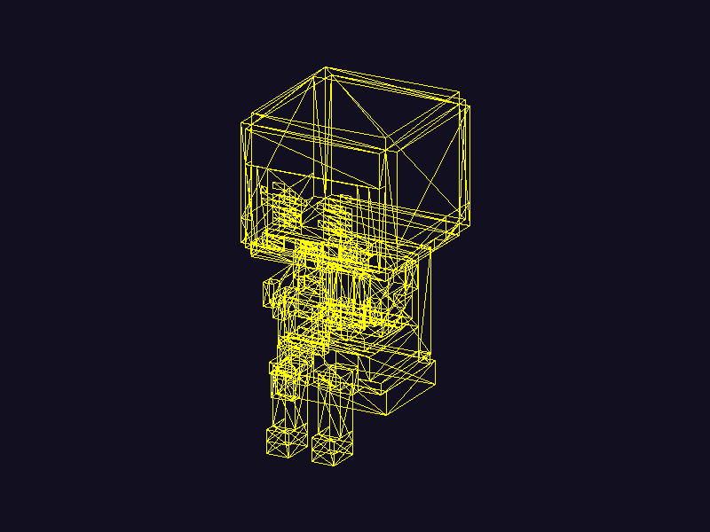

# SR1: carga de un modelo OBJ

Rasterizador por software en Rust. Lee `modelos/personaje_simi_piloto.obj` (el modelo del lab anterior) y lo dibuja con la función de triángulos propia. raylib solo abre la ventana y muestra el framebuffer como textura; cada pixel se pinta a mano.



## Cómo funciona

1. `obj.rs` lee el archivo línea por línea: guarda cada `v` como vértice y cada `f` como una cara con tres índices (acepta `v`, `v/vt`, `v//vn` y `v/vt/vn`).
2. `main.rs` gira el modelo para verlo de frente y un poco de lado, lo escala para que ocupe el 75 % del alto de la pantalla y lo centra.
3. `render()` recorre las caras, toma los tres índices, con ellos saca los tres vértices y llama a `triangulo()`.
4. `triangulo()` une los tres vértices con `linea()` (Bresenham), que pinta pixel por pixel en el framebuffer.

## Ejecutar

Se necesita Rust y las dependencias de compilación de raylib (CMake).

```bash
cargo run
```

Con la ventana abierta, `P` guarda la imagen en `render.png`. Para generarla sin interactuar:

```bash
cargo run -- --captura
```

## Estructura

| Archivo | Contenido |
| --- | --- |
| `src/main.rs` | ventana, transformación a pantalla y recorrido de las caras |
| `src/obj.rs` | lector de `.obj` |
| `src/triangulo.rs` | triángulo como tres líneas |
| `src/linea.rs` | algoritmo de Bresenham |
| `src/framebuffer.rs` | framebuffer RGBA y `punto()` |
| `src/matematica.rs` | `Vec3` y rotaciones |
